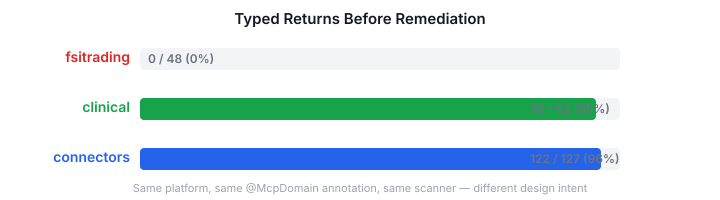
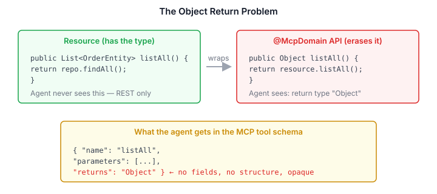

# What 237 MCP Methods Taught Us About Agent API Design

A few days ago I wrote about the gap between APIs designed for developers and APIs consumed by LLM agents — ["The API the Agent Never Asked For"](/articles/2026-11-07-mdp01-the-api-the-agent-never-asked-for). That was one domain, one repo, one set of findings. The conceptual insight was there but the evidence was anecdotal.

This week Claude and I audited 42 `@McpDomain` classes across three production repos — fsitrading (financial services), clinical (clinical trials), and connectors (integration platform). 237 MCP-exposed methods in total. We weren't sampling. We read every method signature, every return type, every parameter list. Then we fixed what was broken.

The data told a story I didn't expect.

## The spectrum



Same platform. Same `@McpDomain` annotation. Same MCP scanner generating the tool schema. Three completely different results.

Clinical and connectors were 95–96% typed from the start — view records, structured results, `OperationResult` on mutations. An agent calling any tool gets back fields it can reason about, compose into follow-up calls, and verify against expectations.

Fsitrading was 0%. Every single method — all 48 — returned `Object`. The underlying resource classes had typed records. `IncidentRecord`, `KpiSummary`, `StrategyTrustView`, `GateResult` — clean, well-structured types sitting right there. But the API layer that the MCP scanner reads declared `Object` on every return, erasing all of it.

An agent calling any fsitrading tool got back opaque JSON with no schema. No field names in the tool definition. No type information. No way to know what it was looking at without dumping the entire response into its context window and parsing it textually.

## The difference isn't code quality

Here's what caught me off guard. Fsitrading isn't bad code. The resource classes are well-structured. The entity model is clean. The service layer separates concerns properly. This is competent Java written by someone who knows what they're doing.

The problem is purely at the API facade — the thin `Fsi*Api` classes that wrap the resources for MCP exposure. Each one is a handful of one-liner methods that delegate to the resource. And every one declares `Object` as the return type.

```java
public Object listAll() {
    return resource.listAll();   // returns List<OrderEntity>
}
```

The resource returns `List<OrderEntity>`. The API erases it to `Object`. The MCP scanner generates a tool with no return type information. The agent is blind.



Clinical and connectors didn't have this problem because their API classes were designed as the agent-facing surface from the start. The return types are the types the agent needs. Fsitrading's API classes were written as a thin wrapper to satisfy the `@McpDomain` annotation requirement — get the tools generated, worry about the schema later.

Later never came.

## A taxonomy of what goes wrong

The audit revealed five distinct failure patterns. Object returns were the worst, but not the only problem.

**Object returns (48 methods in fsitrading).** The type exists in the codebase. The API layer erases it. Fix: change `Object` to the actual type. Mechanical, tedious, but the highest-impact single change — it unlocks the entire MCP surface.

**Void mutations (7 methods across all three repos).** `activateTrial()` returns void. The agent calls it, gets nothing back, and has no way to confirm the trial actually activated. Fix: return the post-mutation state. Clinical's `activateTrial` now returns `TrialView`. Connectors' `deleteContact` now returns `OperationResult(true, platform, contactId, "Contact deleted")`.

**JPA entity leaks (10 methods in fsitrading).** `listAll()` returns `List<OrderEntity>` — a JPA entity with persistence annotations, lazy proxy fields, and internal IDs that mean nothing to an agent. Fix: create view records (`OrderView`, `PositionView`, `StrategyView`) that carry only the domain-relevant fields, with a `toView()` mapper.

**Map\<String, Object\> parameters (2 methods in fsitrading).** `deploy(Map<String, Object> body)` forces the agent to guess parameter names. The resource already had `CreateStrategyRequest(String name, StrategyType strategyType)` — a clean record the API ignored. Fix: accept the typed record.

**Misplaced @McpDomain (1 class in connectors).** `WebhookResource` is a JAX-RS endpoint that receives inbound HTTP webhooks from external systems. It uses `@Context HttpHeaders`, returns raw `Response`, and has no `@PlatformQuery`/`@PlatformMutation` annotations. It shouldn't be an MCP tool at all. Fix: replace `@McpDomain` with `@HandWrittenEndpoint("Webhook receiver — inbound HTTP hooks, not agent-facing")`.

## What the good APIs have in common

Clinical and connectors share patterns worth naming:

**Every mutation returns its result.** Not void, not a status code, not "ok". The post-mutation state. An agent that creates a trial gets back the `TrialView`. An agent that books a flight gets back the `TransportBookingConfirmation`. No follow-up call needed to confirm what happened.

**Cursor-based pagination where it matters.** Connectors uses `Page<T>` with a cursor token the system manages. The agent passes a cursor it got from the previous response — or omits it for the first page. No offset arithmetic, no page-size tuning.

**Incremental sync on temporal domains.** `syncEvents(platform, calendarId, syncToken, pageSize)` returns `SyncResult<CalendarEventInfo>` — just the changes since the last sync token. Three connector domains (calendar, contacts, documents) support this. An agent maintaining awareness doesn't poll and diff — it asks for what's new.

**Structured error metadata.** Connectors throws `UnsupportedCapabilityException` when a platform doesn't support a requested operation. The exception carries which capability was requested, which platform was asked, and what capabilities that platform does support. An agent can self-correct from the error without guessing.

## How to detect these mechanically

Every pattern in the taxonomy can be caught by static analysis. No judgment required — just scan the `@McpDomain` classes.

| Check | What to scan for | Severity |
|-------|-----------------|----------|
| Object returns | Methods returning `Object`, `JsonNode`, `Response` | Critical — agent is blind |
| Void mutations | `@PlatformMutation` methods returning `void` | High — agent can't confirm |
| Entity leaks | Return types annotated with `@Entity` | Medium — persistence model exposed |
| Map params | Parameters of type `Map<String, Object>` | High — agent guesses keys |
| Missing descriptions | `@PlatformQuery`/`@PlatformMutation` with empty or generic text | Medium — agent can't discover |
| Required optionals | Params with sensible defaults but not `Optional<T>` | Low — agent must always specify |

A CI check on `@McpDomain` classes that flags these patterns would have caught fsitrading's 48 Object returns before they shipped. The scanner already parses these classes — extending it to warn on `Object` returns is a small addition with outsized impact.

## The fix was boring

The remediation across all three repos took one session. Fsitrading was the bulk — 48 method signatures changed, 12 new view records created, 2 dead methods removed. Clinical was three method signatures and one new view record. Connectors was five void-to-OperationResult changes and one annotation swap.

None of it was hard. No architectural decisions. No trade-offs. Just changing `Object` to the type that was already there, creating view records for entities that shouldn't leak, and removing methods that didn't work.

That's the uncomfortable part. The fix was always available. The resource layer had the types. The pattern was visible in clinical and connectors. The gap persisted because nobody looked at fsitrading's MCP surface through the agent's eyes.

## The design rule

One sentence: **treat the MCP surface as its own design artefact, not a projection of the Java API.**

The platform's `@McpDomain` makes it trivially easy to expose Java methods as MCP tools. That's a strength for velocity. But it creates a trap: the MCP surface inherits whatever the Java method signature says. If the Java method returns `Object` because the developer didn't need the type there — the agent doesn't get the type either. If the Java method takes `Map<String, Object>` because the developer was prototyping — the agent has to guess the keys.

The fix is to review `@McpDomain` classes the way you'd review a REST API contract. Not as an internal implementation detail, but as a surface that external consumers depend on. The consumer happens to be an LLM agent instead of a frontend developer. It still deserves typed returns, documented parameters, and confirmation of mutations.

Three questions to ask of any `@McpDomain` class before it ships:

1. **Can the agent reason about the return type?** If the schema says `Object`, the answer is no.
2. **Can the agent confirm what happened?** If the mutation returns void, the answer is no.
3. **Can the agent construct the request from the schema alone?** If it needs to guess keys in a Map or know internal enums from memory, the answer is no.

Zero of these require deep architectural work. All of them are fixable in the method signature.
