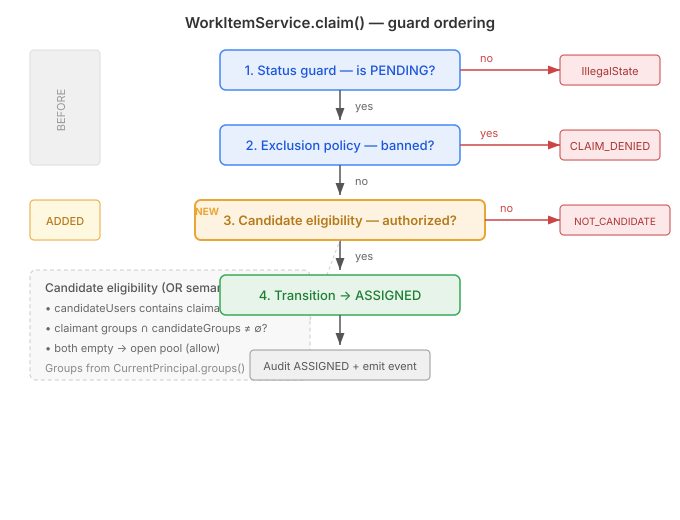

# The Claim That Didn't Check

`WorkItemService.claim()` had an exclusion policy check. If you were on the exclusion list, you couldn't claim. If you weren't, you could claim anything. The candidateUsers and candidateGroups fields — the ones that say who is *supposed* to handle this work — were checked nowhere in the claim path.

This is a specific instance of a general pattern: authorization that only protects against what you *can't* do, without verifying what you're *supposed* to do. Exclusion is a blacklist. Candidacy is a whitelist. You need both, and the blacklist alone creates the illusion of access control while leaving the front door open.

## What was missing

A WorkItem can declare `candidateUsers` (comma-separated user IDs) and `candidateGroups` (comma-separated group names). These exist on the domain model, they're set at creation time, they're used by the assignment strategies for auto-routing, they're queryable in the inbox. But `claim()` — the manual path where a human says "I'll take this one" — only checked the exclusion policy and the status guard. If you weren't excluded and the item was PENDING, you were in.

The fix goes between the exclusion check and the status transition, following the guard ordering that the codebase already established: status guard first (prevents phantom audit entries on non-claimable items), exclusion check second, then the new candidate eligibility check third. If the claimant is in `candidateUsers`, they pass. If their `CurrentPrincipal.groups()` overlaps with `candidateGroups`, they pass. If both lists are empty, it's an open pool — anyone can claim. Otherwise, the attempt is audited as `CLAIM_NOT_CANDIDATE` and rejected.

The OR semantics matter. BPMN and CMMN treat candidateUsers and candidateGroups as a union: you're eligible if you match either. A user listed by name but not in the right group can still claim. A group member who isn't listed by name can still claim. This is the standard human task model and the one CaseHub follows.

## The test infrastructure gap

The fix was about 30 lines. The test infrastructure changes were larger.

CaseHub Work's `TenantScopedPrincipal` — the `CurrentPrincipal` implementation for request-scoped contexts — returned `Set.of()` for `groups()`. This was correct before: nothing consumed groups. But with the candidate check in place, every integration test that created a WorkItem with `candidateGroups` and then claimed it started failing. The principal had no groups, so no group-based candidate check could pass.

The production fix was straightforward: add `groups` to `TenantHolder` (the request-scoped state bean) and delegate `TenantScopedPrincipal.groups()` to it, matching the existing pattern for `actorId` and `tenancyId`.

The test fix revealed something more interesting. The `@QuarkusTest` classes use `MutableCurrentPrincipal` — a test-only `@Alternative @Priority(200)` bean that beats the production principal. It already had `setGroups()`. But no test had ever called it. The groups field existed, the setter existed, the bean was wired — and the capability was invisible because nothing needed it until the candidate check landed.

This is the pattern that makes authorization gaps hard to find: the infrastructure is half-built, the tests pass because nothing exercises the missing half, and the gap only becomes visible when you wire the check that depends on it. If I'd searched for `setGroups` in the test codebase before this change, I'd have found it and assumed groups were covered. They weren't — the method existed and was never called.

## The broader pattern

There's a category of authorization check I think of as "negative-only" — systems that verify you aren't prohibited but don't verify you're authorized. It shows up everywhere:

- Firewalls that block known bad IPs but don't verify the source is in an allowlist
- API endpoints that check `@RolesAllowed` for denial but don't verify the caller has the specific resource-level permission
- Workflow engines that check whether a user is suspended but not whether they're assigned to this case

The fix is always the same: add the positive check alongside the negative one. The difficulty is noticing the gap, because the negative check creates enough security theatre to feel complete. Everything appears guarded. The tests pass. The audit trail shows denied attempts. The system just also allows anyone who isn't denied.

The garden had a relevant entry — GE-20260719-4e2784 — documenting that `@TestSecurity(roles = ...)` doesn't populate `CurrentPrincipal.groups()`. The test infrastructure gap we hit was the same shape: Quarkus security sets roles on `SecurityIdentity`, not on the platform's `CurrentPrincipal`. A test that relies on `@TestSecurity` for group-based filtering gets HTTP 200 with zero results and no warning. The fix is the same: inject the test principal and call `setGroups()` explicitly.

The `TenantContextRunner` — which establishes request contexts for background work — still doesn't thread groups through. No current caller claims via that path, so it's not a bug today. But it's a gap that would bite the first time someone adds a background claim. I've filed it.
